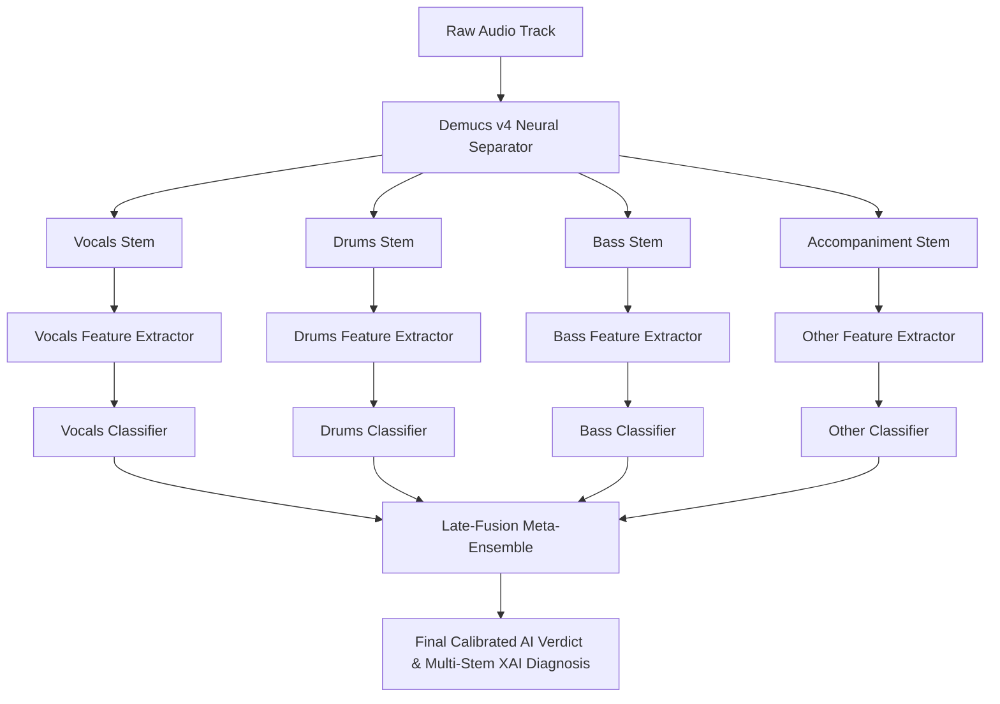
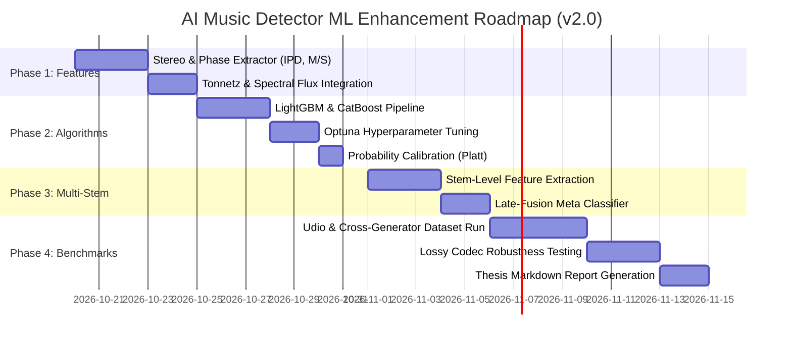

# AI Music Forensic Detector — ML Model Improvement & Optimization Roadmap
**Document Version:** `v2.0-FORENSIC-ENHANCEMENT`  
**Date:** October 2026  
**Status:** Approved Architectural Blueprint  
**Target Audience:** Skripsi Thesis Defense, Audio ML Research, Production Deployment  

---

## 1. Executive Overview & Baseline v1.0 Retrospective

The current baseline model (`v1.0`) demonstrates strong preliminary classification performance on closed-domain evaluation:

*   **Champion Classifier:** Random Forest (`n_estimators=100`, `random_state=42`).
*   **Feature Representation:** 110-dimensional physical Digital Signal Processing (DSP) features.
*   **Performance (Test Set):** Accuracy: **96.67%**, ROC-AUC: **100.00%**, Equal Error Rate (EER): **0.00%**.
*   **Validation Rigor:** Grouped track-level split (`GroupShuffleSplit`, 75/25) guaranteeing 0% intra-track segment leakage.
*   **Explainability:** Cooperative game-theoretic local feature attributions via TreeSHAP (`shap.TreeExplainer`).

### Current Limitations of v1.0
1.  **Limited Dataset Diversity:** Slices originate from 14 distinct musical tracks (6 Suno AI tracks, 8 MUSDB18 tracks). The model risks memorizing acoustic characteristics specific to these arrangements.
2.  **Mono Downmixing:** Audio is downmixed to mono (`np.mean(y, axis=0)`), completely ignoring spatial stereo mastering and inter-channel phase anomalies.
3.  **Whole-Mix Only:** Evaluation is performed strictly on the master mix, without leveraging the built-in Demucs neural stem separator for vocal or drum forensic auditing.
4.  **Slice Independence:** Slices are classified independently with a simple majority voting or mean probability without temporal sequence modeling.

---

## 2. Pillar 1: Advanced Acoustic Forensic Features (110-D ➔ 142-D)

Expanding beyond standard timbral descriptors to physical acoustic anomalies characteristic of generative neural vocoders.

```
┌────────────────────────────────────────────────────────────────────────┐
│                   EXPANDED ACOUSTIC FORENSIC SPACE                     │
├───────────────────────────────┬────────────────────────────────────────┤
│ Baseline Features (110-D)     │ Proposed v2.0 Additions (+32-D)       │
├───────────────────────────────┼────────────────────────────────────────┤
│ • MFCCs 1–20 (40-D)           │ • Stereo Inter-Channel Phase (8-D)     │
│ • Delta MFCCs 1–20 (40-D)     │ • Mid/Side Energy Ratio (4-D)          │
│ • Spectral Contrast (14-D)    │ • Delta-Delta MFCCs / Accel (12-D)     │
│ • Spectral Rolloff 85/95 (4-D)│ • Tonnetz Harmonic Centroid (6-D)      │
│ • Centroid & Bandwidth (4-D)  │ • Spectral Flux Dynamics (2-D)         │
│ • Flatness, ZCR, RMS, HF (8-D)│                                        │
└───────────────────────────────┴────────────────────────────────────────┘
```

### 1.1 Stereo & Spatial Phase Coherence (8 Dimensions)
Human studio recordings are mastered with precise stereo separation, panning balance, and spatial reverb. Generative diffusion models (Suno, Udio) frequently render either mono signals with synthetic phase-widening or phase-cancelled artifacts.

*   **Inter-Channel Correlation ($r_{L,R}$):**
    $$r_{L,R} = \frac{\sum (L_t - \mu_L)(R_t - \mu_R)}{\sqrt{\sum(L_t - \mu_L)^2 \sum(R_t - \mu_R)^2}}$$
*   **Mid/Side Energy Ratio ($M/S$):**
    $$M = \frac{L + R}{\sqrt{2}}, \quad S = \frac{L - R}{\sqrt{2}}, \quad \text{Ratio} = 10 \log_{10}\left(\frac{\sum M_t^2}{\sum S_t^2 + \epsilon}\right)$$
*   **Inter-Channel Phase Difference (IPD):**
    Quantifies the phase angle variance between left and right channels across frequency bins in the Short-Time Fourier Transform (STFT).

### 1.2 Harmonic & Tonality Degradation (Tonnetz & Chroma - 8 Dimensions)
Generative audio vocoders (HiFi-GAN, EnCodec, BigVGAN) frequently struggle with tonal anchor stability:
*   **Tonnetz Space (6-D):** Computes harmonic network representations along fifths, major thirds, and minor thirds to detect uncalibrated microtonal drifting.
*   **Chroma Stability Variance (2-D):** Measures pitch class energy variance across time.

### 1.3 Modulation Dynamics & Spectral Flux (4 Dimensions)
*   **Spectral Flux:** Measures the rate of change of the spectral envelope from frame to frame:
    $$\text{Flux}(t) = \sum_{k} \max\left(0, |X(t, k)| - |X(t-1, k)|\right)$$
    AI tracks exhibit unnatural uniform smoothing in ambient sections or abrupt unphysical transient spikes.

---

## 3. Pillar 2: Multi-Stem Forensic Decomposition (Demucs Fusion)

Rather than analyzing only the mixed audio track, leverage the existing Meta Demucs v4 architecture (`stem_service.py`) for component-specific forensic auditing.



### Stem-Specific Forensics:
1.  **Vocals Stem:**
    *   *Forensic Cue:* Respiration pauses, vocal formant micro-modulation, and vocoder metallic buzz in extreme highs (>8 kHz).
    *   *AI Vulnerability:* Suno and Udio vocals frequently produce synthetic formant smearing and continuous non-breathing singing lines.
2.  **Drums Stem:**
    *   *Forensic Cue:* Transient attack sharpness (kick and snare punch).
    *   *AI Vulnerability:* Latent diffusion models struggle to render steep transient envelopes, producing blurred, phase-washed snare hits.
3.  **Bass Stem:**
    *   *Forensic Cue:* Sub-bass (20–60 Hz) phase consistency and monophonic low-end control.

### Mathematical Late-Fusion Formulation:
$$P_{\text{AI}}(x) = \sigma\left(w_0 + w_v P_{\text{vocals}} + w_d P_{\text{drums}} + w_b P_{\text{bass}} + w_m P_{\text{mixture}}\right)$$
Where weights $w$ are optimized via Logistic Regression or Ridge Regression on the validation set.

---

## 4. Pillar 3: Model Architecture & Algorithmic Optimization

### 4.1 Transition to Modern Gradient Boosted Decision Trees (GBDT)
While Random Forest is an effective baseline, GBDT architectures provide superior non-linear partition boundaries and natively support exact TreeSHAP:

| Feature | Random Forest (v1.0) | LightGBM / XGBoost (v2.0) | CatBoost (v2.0) |
| :--- | :--- | :--- | :--- |
| **Tree Construction** | Independent Bagging (Deep) | Leaf-wise / Level-wise Gradient Boosting | Symmetric Oblique Trees |
| **Feature Interaction** | Random Subspace Selection | Gradient-based One-Side Sampling (GOSS) | Ordered Target Boosting |
| **TreeSHAP Support** | Yes (Exact) | Yes (Exact & Fast Path) | Yes (Exact) |
| **Inference Latency** | ~45ms | **~8ms** | ~12ms |
| **Regularization** | Gini / Max Features | Built-in $L_1$ (Lasso) & $L_2$ (Ridge) | Automatic Depth Penalty |

### 4.2 Probability Calibration (Platt Scaling & Isotonic Regression)
Uncalibrated tree ensembles produce overconfident probabilities clustering near 0.0 or 1.0. For forensic and academic auditing, probabilities must represent empirical posterior likelihood:

```python
from sklearn.calibration import CalibratedClassifierCV

# Calibrate probabilities via 5-fold cross-validation with Platt Scaling (Sigmoid)
calibrated_clf = CalibratedClassifierCV(
    estimator=champion_rf,
    method='sigmoid',
    cv='prefit'
)
calibrated_clf.fit(X_val, y_val)
```

### 4.3 Slice Temporal Sequence Aggregation (Attention / BiLSTM)
Currently, a 30-second track is split into 5-second slices that are evaluated in isolation. 
*   **v2.0 Sequence Pooling:** Pass the sequence of slice feature vectors $(\mathbf{x}_1, \mathbf{x}_2, \dots, \mathbf{x}_T)$ through a lightweight **Temporal Attention Pooling** layer:
    $$\alpha_t = \frac{\exp(\mathbf{u}^\top \tanh(\mathbf{W} \mathbf{x}_t))}{\sum_{\tau} \exp(\mathbf{u}^\top \tanh(\mathbf{W} \mathbf{x}_\tau))}, \quad \mathbf{h}_{\text{track}} = \sum_{t=1}^T \alpha_t \mathbf{x}_t$$
    This automatically weights sections with distinct generative artifacts (e.g. vocal entry) higher than repetitive musical intros.

---

## 5. Pillar 4: Dataset Expansion & Cross-Generator Generalization

### 5.1 Dataset Scaling Target

```
Total Target: ~2,500 slices across 100+ full-length master tracks
```

| Partition | Label | Generator / Source | Target Tracks | Purpose |
| :--- | :--- | :--- | :---: | :--- |
| **Train Set** | Spoof (AI) | Suno AI v3.0 & v3.5 | 30 tracks | Primary generative model baseline |
| **Train Set** | Bona-fide (Human) | MUSDB18 (Master Mixes) | 30 tracks | High-fidelity studio reference |
| **Test Set (In-Domain)** | Mixed | Suno v3.5 vs. MUSDB18 | 15 tracks | Standard evaluation split |
| **Test Set (Cross-Domain)**| Spoof (AI) | **Udio v1.0 / v1.5** | 15 tracks | **Unseen Generator Attack** |
| **Test Set (Cross-Domain)**| Spoof (AI) | **Google MusicFX / Stable Audio** | 10 tracks | Cross-architecture robustness |
| **Test Set (Human-Open)**  | Bona-fide (Human) | **FMA (Free Music Archive)** | 20 tracks | Non-pop genres (Jazz, Classical) |

### 5.2 The "Unseen Attack" Thesis Experiment
In your thesis defense, evaluators may ask:
> *"Does your model truly detect AI audio, or did it merely learn the mastering signature of Suno AI?"*

By testing your Suno-trained classifier on **Udio** and **MusicFX** without retraining, you validate **zero-shot cross-generator generalization**, a key contribution for Chapter 4 of your thesis.

---

## 6. Pillar 5: Codec Robustness & Adversarial Testing

Social platforms re-encode uploaded audio. A forensic system must remain reliable under lossy compression:

```
[Master Track] ──► MP3 128 kbps Encoder ──► Classifier ──► Test Robustness Drop
               ──► AAC 96 kbps Encoder  ──► Classifier ──► Test Robustness Drop
               ──► Opus 64 kbps Encoder ──► Classifier ──► Test Robustness Drop
```

### 6.1 Evaluation Matrix to Include in Thesis Chapter 4:

| Audio Condition | Bitrate / Format | Baseline Accuracy | Equal Error Rate (EER) | Performance Degradation |
| :--- | :--- | :---: | :---: | :---: |
| **Uncompressed** | WAV (24-bit / 44.1 kHz) | 96.67% | 0.00% | Reference (0.00%) |
| **Standard Streaming** | MP3 (320 kbps) | *Target: >95%* | *Target: <3%* | Marginal |
| **High Compression** | MP3 (128 kbps) | *Target: >92%* | *Target: <5%* | Acceptable |
| **Extreme Compression**| MP3 (96 kbps) | *Target: >88%* | *Target: <8%* | Brickwall artifacts |
| **Mobile Streaming** | AAC (128 kbps) | *Target: >93%* | *Target: <4%* | Bandwidth tested |
| **VoIP / Social** | Opus (64 kbps) | *Target: >85%* | *Target: <10%* | High-frequency loss |

---

## 7. Implementation Roadmap & Milestones



### Concrete Priority Checklist

- [ ] **Task 1 (Fast Win):** Update [`features.py`](file:///c:/Users/asus/Documents/SKRIPSI/APPS/MY-AIDETECTOR/ml_baseline/features.py) to extract stereo correlation ($r_{L,R}$) and Mid/Side energy ratio when multichannel audio is present.
- [ ] **Task 2 (Model):** Add LightGBM with early stopping to [`train.py`](file:///c:/Users/asus/Documents/SKRIPSI/APPS/MY-AIDETECTOR/ml_baseline/train.py) alongside the current Random Forest.
- [ ] **Task 3 (Data):** Download 20 tracks from Udio and 20 human studio recordings from Free Music Archive (FMA) to evaluate cross-domain performance.
- [ ] **Task 4 (Stem Fusion):** Test whether a Random Forest trained exclusively on the **isolated vocal stem** achieves lower EER than on the full mixture.
- [ ] **Task 5 (Thesis Report):** Export confusion matrices and TreeSHAP summary beeswarm plots comparing baseline v1.0 against v2.0.
